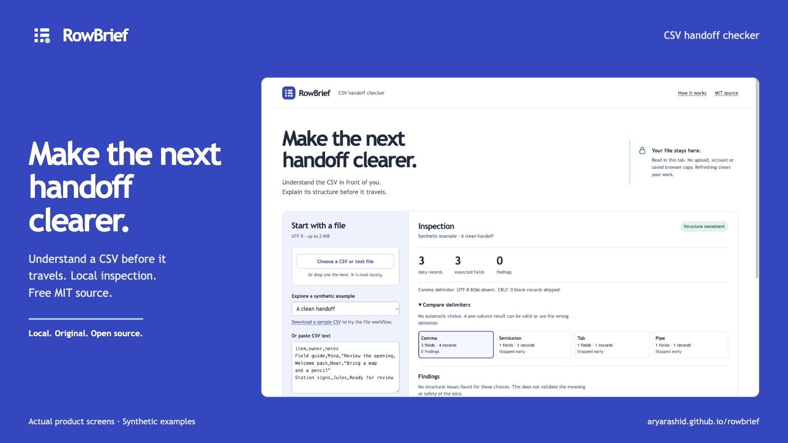
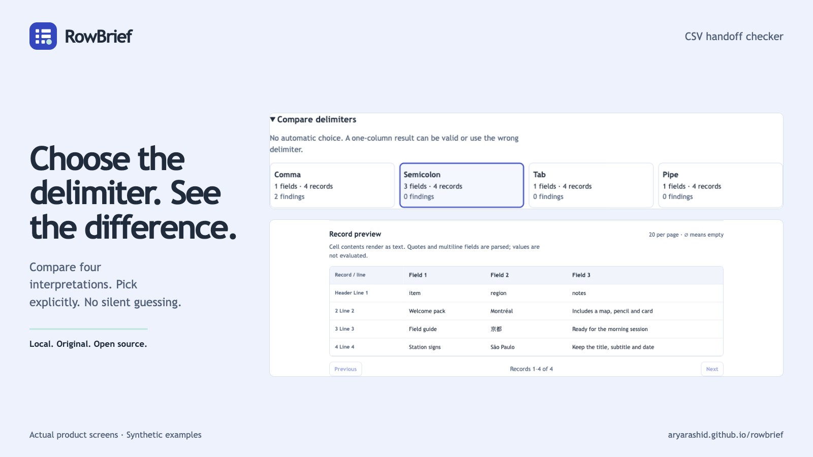
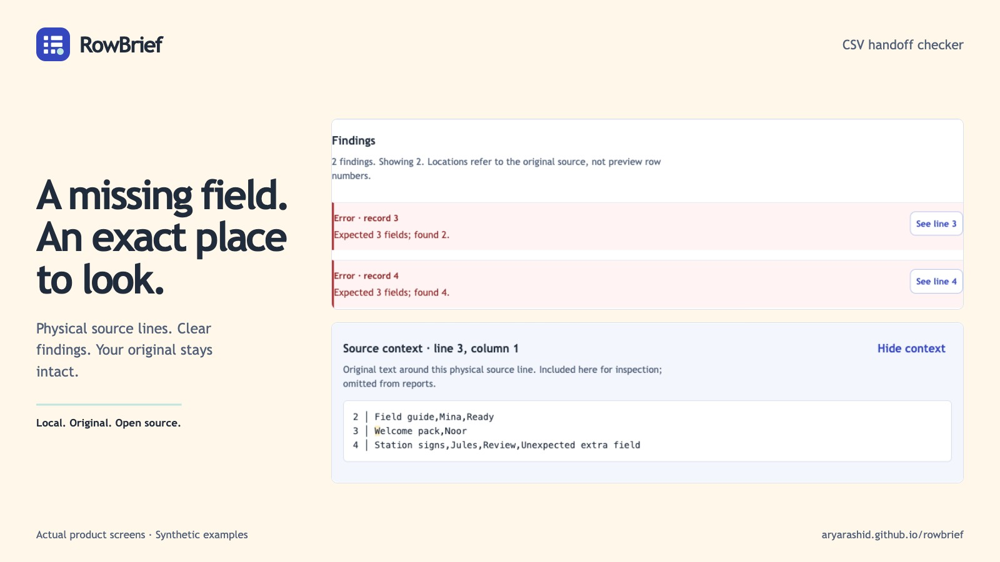
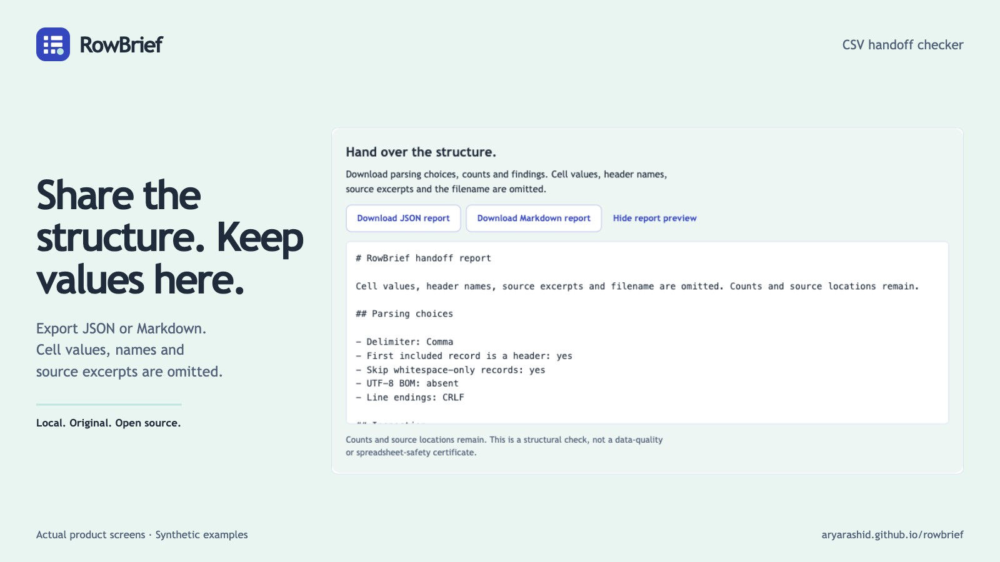
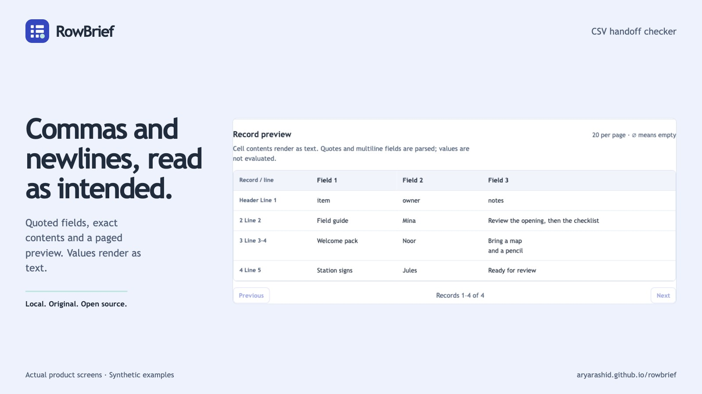

<p align="center"></p>

# RowBrief

> Pre-release snapshot prepared October 23, 2026. No GitHub/demo or marketplace publication is claimed yet. See [verification](./docs/verification.md) for remaining checks.

**Make the next handoff clearer.** A local CSV workbench that explains a file's structure before you pass it on. Compare delimiters, find the physical source line behind a structural problem, and export a report without cell values.

[Open the live tool](https://aryarashid.github.io/rowbrief/) · [Product gallery](https://aryarashid.github.io/rowbrief/marketplace/) · [Run locally](#run-locally) · [Contribution guide](./CONTRIBUTING.md)



Original MIT software by [Arya Rashid](https://github.com/aryarashid), built with AI assistance. No purchase, account, backend, API key or runtime dependency is required. All product examples and screenshots are synthetic.

## What it does

- Inspect one UTF-8 CSV, TSV or delimited text file locally, or paste text.
- Compare comma, semicolon, tab and pipe interpretations. Choose explicitly; a one-column result is not assumed wrong.
- Parse quoted delimiters, doubled quotes and multiline fields. Fatal quoting stops inspection and labels results as partial.
- Check row widths against the first included record, plus empty and exact-duplicate headers when header mode is on.
- Locate each finding by one-based physical source line and Unicode-code-point column. A paged preview and source context help you inspect it.
- Download JSON or Markdown reports containing parsing choices, counts and findings. Cell values, header names, source excerpts and the filename are always omitted.

## Run locally

Install Node.js 22 or later and Git:

```sh
git clone https://github.com/aryarashid/rowbrief.git
cd rowbrief
npm ci
npm start
```

Open **http://127.0.0.1:4186**. No build step is needed. Use `PORT=4187 npm start` for another port. The server binds to loopback only. Opening `index.html` directly from disk does not support module loading. For a public deployment, serve the static files over HTTPS. GitHub Pages can serve the repository root. The development server adds a restrictive content security policy; static hosting may use different headers.

## Try the workflow

1. Choose **Locate a broken record**. The synthetic file contains one two-field record and one four-field record, against a three-field header.
2. Select **See line 3** to inspect the missing field in the original text. Nothing is silently fixed.
3. Choose **Find the delimiter**. This UTF-8 BOM example uses semicolons and includes Montréal, 京都 and São Paulo. Compare another delimiter, then choose semicolon again.
4. Preview or download a report. It includes the selected dialect and findings, not those cell values or the filename.

Portable examples are in [examples](./examples). Clean and deliberately malformed files are labeled by filename.

## Screenshots

| Explicit delimiter choices | Exact source locations |
| --- | --- |
| [](./marketplace/images/02-dialects.jpg) | [](./marketplace/images/03-findings.jpg) |
| **Reports without cell values** | **Quoted and multiline records** |
| [](./marketplace/images/04-report.jpg) | [](./marketplace/images/05-preview.jpg) |

## Privacy and limits

Files are read in this tab using browser APIs. The app makes no upload or analytics request and uses no local storage, cookies or service worker. Refresh or Clear removes the app's working copy; this is not a claim of secure memory erasure or protection from browser extensions, the operating system or someone viewing the screen. Downloaded reports remain on your device. Report counts and source locations can still be sensitive; review before sharing. A public host can receive ordinary page-request metadata.

Imported files retain decoded original text, line endings and byte counts until you edit the textarea. Browsers normalize pasted or edited textarea newlines to LF; the source label explains when that interpretation is in use. The on-disk original is never modified. There is no cleaned-file or converted-file export.

Limits are **2 MiB UTF-8**, **10,000 parsed records**, **100 fields per record** and the **first 200 findings**. Blank records count toward the parser limit. Preview shows 20 included records per page, with each cell display limited to 200 characters. Source context is clipped around the finding. UTF-16/32 are unsupported. BOM-marked unsupported encodings, malformed UTF-8 and NUL characters are rejected; no general encoding detector is claimed. A leading BOM is excluded from visible columns; CRLF counts as one physical line break.

Whitespace-only single-field records may be skipped explicitly. Delimiter-only records, including tab-separated empty fields, are preserved. Quoted whitespace is not a blank record. Width is compared with the first included record even when header mode is off. Duplicate headers are exact, case-sensitive matches; no names are trimmed or renamed. Mixed line-ending warnings include line breaks inside quoted fields.

**Structure only:** no business-rule, data-type, formula-safety, automatic encoding-conversion or universal spreadsheet-compatibility certification. Values render as text and are never evaluated. A structurally consistent file can still contain incorrect or unsafe data for another application. There is no background saving, collaboration, repair engine or guaranteed offline cache. You can run the complete app locally without Internet access after obtaining it.

Keyboard users can reach controls with Tab, activate with Enter/Space and scroll the preview region independently. Findings have descriptive source buttons and text states. The verification record describes mobile and keyboard checks; no independent assistive-technology audit is claimed.

## Development, support and license

`npm run check` runs syntax checks and the focused Node test suite. See [architecture](./docs/architecture.md), [verification](./docs/verification.md), [demand evidence and alternatives](./docs/research.md) and [contributing](./CONTRIBUTING.md).

[GitHub issues](https://github.com/aryarashid/rowbrief/issues) are the community support channel. Use synthetic reproductions and omit private files or logs. No maintenance agreement, response-time promise or paid support is included.

Original code, examples, artwork and docs use [MIT](./LICENSE). Keep its copyright and permission notice with redistributed copies. [Third-party notices](./THIRD_PARTY_NOTICES.md) document external prerequisites and system fonts; no parser, font or npm dependency is bundled. Any marketplace listing is a separate publication surface. No marketplace purchase is required for this repository or live tool.
